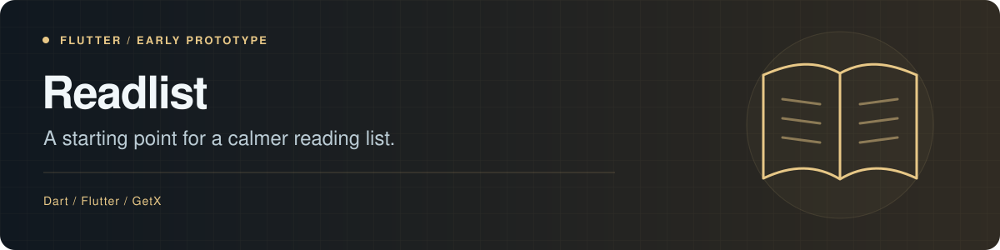

<p align="center">
  
</p>

<p align="center">
  <strong>Dart · Flutter · GetX</strong><br />
  The foundation for a simple app to organize what you want to read.
</p>

<p align="center">
  <a href="#current-status">Current status</a> · <a href="#getting-started">Getting started</a> · <a href="#project-structure">Project structure</a>
</p>

## Overview

Readlist is an early Flutter project intended to become a reading-list tracker. The current repository establishes the application shell, routing, and GetX module structure.

## Current status

**Early prototype.** The app currently opens a placeholder home screen. Reading-list creation, editing, completion states, and persistent storage are future work.

| Available now | Intended next steps |
| --- | --- |
| `GetMaterialApp` application shell | Add and edit reading entries |
| GetX routes and home binding | Track reading status |
| Home view and controller scaffold | Save the list between sessions |
| Generated platform runner projects | Add focused UI and controller tests |

## Getting started

Install Flutter with a Dart SDK satisfying **`>=3.1.0 <4.0.0`**, as declared in `pubspec.yaml`. Set up a supported device, emulator, or browser with `flutter doctor`.

```bash
git clone https://github.com/rizqiramadhannn/readlist-app.git
cd readlist-app
flutter pub get
flutter devices
flutter run
```

The current screen displays **“HomeView is working”**. Platform folders are present for Android, iOS, web, Windows, macOS, and Linux; their presence does not establish feature support or testing on every platform.

### Useful commands

| Command | Purpose |
| --- | --- |
| `flutter doctor` | Check the local Flutter toolchain |
| `flutter pub get` | Resolve Dart and Flutter dependencies |
| `flutter analyze` | Run static analysis |
| `flutter run -d <device-id>` | Launch on a device listed by `flutter devices` |

## Project structure

```text
lib/
├── main.dart
└── app/
    ├── routes/                   Route names and page registration
    └── modules/home/
        ├── bindings/             Controller registration
        ├── controllers/          Home controller scaffold
        └── views/                Placeholder home screen
```

## Development direction

Start with a small reading-entry model, connect it to the home controller, then build the list and add/edit flow. Persistence and tests can follow that first complete interaction.

---

Made by [Rizqi Ramadhan](https://rizqiramadhan.dev).
